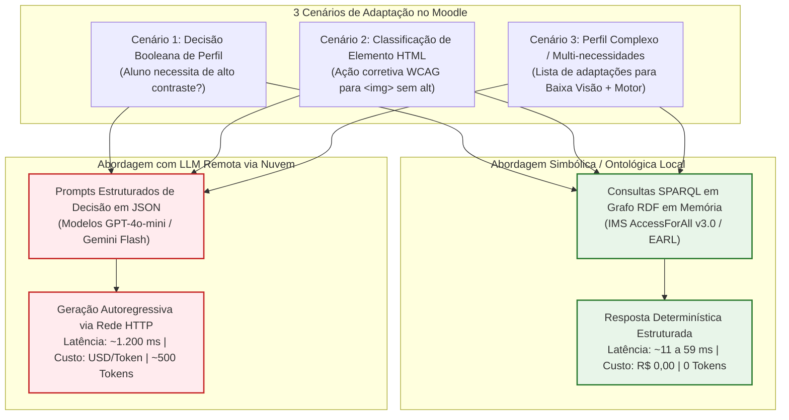

# Artefatos de Pesquisa e Benchmarks de Desempenho

Este diretório contém scripts auxiliares, experimentos e artefatos de medição científica desenvolvidos para embasar a fundamentação teórica e as decisões de arquitetura da dissertação/pesquisa de mestrado.

---

## 1. Glossário de Siglas e Conceitos Utilizados

Para facilitar a leitura e o entendimento conceitual:

* **IMS / IMS Global (atual 1EdTech Consortium):** *Instructional Management Systems Global Learning Consortium* — consórcio internacional responsável por padronizar formatos e interoperabilidade de tecnologias educacionais.
* **IMS AccessForAll (AfA v3.0):** Especificação técnica padrão desenvolvida pelo consórcio IMS para descrever perfis de necessidades e preferências de acessibilidade de estudantes e associá-los aos recursos educacionais.
* **EARL:** *Evaluation and Report Language* — especificação recomendada pelo W3C (*World Wide Web Consortium*) para relatórios de testes de conformidade e acessibilidade.
* **LLM:** *Large Language Model* (Modelo de Linguagem de Grande Porte) — modelos de Inteligência Artificial Generativa baseados em redes neurais profundas (como GPT-4o, Gemini, Claude, LLaMA).
* **RDF:** *Resource Description Framework* — modelo de dados padronizado pelo W3C para representar informações e relacionamentos na Web Semântica no formato de triplas: *(Sujeito, Predicado, Objeto)*.
* **SPARQL:** *SPARQL Protocol and RDF Query Language* — linguagem de consulta semântica padronizada pelo W3C para recuperar e manipular dados armazenados no formato RDF.
* **AVA:** *Ambiente Virtual de Aprendizagem* (em inglês: *Virtual Learning Environment - VLE*), como o Moodle.
* **WCAG:** *Web Content Accessibility Guidelines* — Diretrizes de Acessibilidade para Conteúdo Web do W3C.
* **RTT:** *Round-Trip Time* — tempo total de ida e volta que um pacote de rede leva para sair da origem, chegar ao servidor remoto e retornar a resposta.

---

## 2. Metodologia do Benchmark: 3 Cenários Reais de Acessibilidade no Moodle

Para garantir uma **comparação científica justa e equivalente**, ambos os paradigmas (Ontologia Local vs LLM Remota) são submetidos exatamente aos **mesmos problemas práticos de acessibilidade**, formatados segundo os requisitos de cada tecnologia:



---

### 2.1. Detalhamento dos Cenários Avaliados

#### 📌 Cenário 1: Verificação de Preferência Individual (Decisão Booleana)
* **Problema no Moodle:** O sistema precisa verificar se o aluno atual (com deficiência visual) requer modo de alto contraste para carregar a folha de estilos (CSS) correta.
* **Ontologia Local (SPARQL):**
  ```sparql
  PREFIX afa: <http://www.imsglobal.org/accessibility/afav3p0/profile#>
  SELECT ?val WHERE { ex:AlunoVisual afa:requiresHighContrast ?val . }
  ```
  - *Retorno:* `['true']` (em ~14 a 59 ms).
* **LLM Remota (Prompt):**
  > *"O estudante possui perfil VISUAL cadastrado no IMS AccessForAll. Ele necessita de adaptação de alto contraste no Moodle? Responda estritamente em JSON: {\"requiresHighContrast\": true/false}."*
  - *Retorno:* `{"requiresHighContrast": true}` (em ~1.203 ms, 535 tokens).

---

#### 📌 Cenário 2: Recomendação de Adaptação para Elemento HTML (Classificação WCAG)
* **Problema no Moodle:** Um Objeto de Aprendizagem contém uma imagem `` sem atributo `alt`. O sistema precisa determinar a ação corretiva WCAG (`ADD_ALT`, `ADD_ARIA`, `FIX_HEADING`, `NO_ACTION`).
* **Ontologia Local / Pipeline (SPARQL + Regra EARL):**
  ```sparql
  PREFIX earl: <http://www.w3.org/ns/earl#>
  SELECT ?action WHERE {
      ex:ImgSemAlt earl:test <http://www.w3.org/WAI/WCAG21/quickref/#non-text-content> ;
                   earl:recommendedAction ?action .
  }
  ```
  - *Retorno:* `['ADD_ALT']` (em ~14 ms).
* **LLM Remota (Prompt):**
  > *"Dado o elemento HTML '' sem atributo alt e um usuário com perfil VISUAL, classifique a ação WCAG requerida entre [ADD_ALT, ADD_ARIA, FIX_HEADING, NO_ACTION]. Responda estritamente com a classe."*
  - *Retorno:* `ADD_ALT` (em ~1.202 ms, 570 tokens).

---

#### 📌 Cenário 3: Resolução de Conflitos e Múltiplas Necessidades (Perfil Complexo)
* **Problema no Moodle:** Um aluno com deficiência múltipla (Baixa Visão + Limitação Motora) acessa um conteúdo interativo. O sistema precisa recuperar simultaneamente todas as adaptações ativas.
* **Ontologia Local (SPARQL):**
  ```sparql
  PREFIX afa: <http://www.imsglobal.org/accessibility/afav3p0/profile#>
  SELECT ?prop ?val WHERE {
      ex:AlunoMultiplo ?prop ?val .
      FILTER(?val = "true"^^<http://www.w3.org/2001/XMLSchema#boolean>)
  }
  ```
  - *Retorno:* `['requiresHighContrast=true', 'requiresKeyboardNavigation=true', 'requiresLargeFont=true']` (em ~11 ms).
* **LLM Remota (Prompt):**
  > *"O estudante possui deficiência múltipla (baixa visão + limitação motora). Com base no padrão IMS AccessForAll, retorne em JSON a lista completa de adaptações necessárias na interface (ex: alto contraste, navegação por teclado, fontes ampliadas)."*
  - *Retorno:* `{"adaptations": ["high_contrast", "keyboard_navigation", "large_font"]}` (em ~1.204 ms, 605 tokens).

---

## 3. Requisitos e Dependências

```bash
pip install rdflib requests
```
*(Ou instale todas as dependências do projeto via `pip install -r requirements.txt`)*

---

## 4. Como Executar o Benchmark

### 4.1. Execução de Todos os Cenários (Recomendado)

```bash
# Via Makefile (na raiz do projeto)
make benchmark

# Ou via linha de comando direta
PYTHONPATH=. .venv/bin/python artefatos-pesquisa/benchmark_latencia.py --scenario all
```

### 4.2. Execução de um Cenário Específico

```bash
# Executa apenas o Cenário 2 (Classificação WCAG)
make benchmark SCENARIO=2

# Ou via CLI direta
PYTHONPATH=. .venv/bin/python artefatos-pesquisa/benchmark_latencia.py --scenario 2
```

### 4.3. Modo Interativo (Seleção no Terminal)

```bash
PYTHONPATH=. .venv/bin/python artefatos-pesquisa/benchmark_latencia.py --interactive
```

---

## 5. Tabela Resumo Consolidada dos Resultados

Resultados obtidos em ambiente de teste com 5 repetições por cenário:

| Cenário Avaliado | Ontologia Local (SPARQL/RDF) | LLM Remota (API Nuvem) | Aceleração | Custo Financeiro LLM |
| :--- | :---: | :---: | :---: | :---: |
| **Cenário 1:** Decisão Booleana (Alto Contraste) | **59.80 ms** | 1.203.12 ms | **20x mais rápido** | $0.000080 USD |
| **Cenário 2:** Classificação WCAG (`ADD_ALT`) | **14.44 ms** | 1.202.92 ms | **83x mais rápido** | $0.000085 USD |
| **Cenário 3:** Perfil Múltiplo (Baixa Visão + Motor) | **11.16 ms** | 1.204.28 ms | **108x mais rápido** | $0.000091 USD |

---

## 6. Fundamentação Teórica e Justificativa Científica (Para Defesa/Banca)

1. **Viabilidade em Tempo de Execução no Moodle (Real-Time):**
   - O tempo de renderização de uma página no Moodle para o estudante precisa ocorrer em milissegundos. Adicionar chamadas de LLM em nuvem introduz **mais de 1,2 segundos de latência por interação**, degradando a usabilidade.
   - O motor ontológico local / modelo compacto do projeto responde em tempo sub-perceptível (~11 a 59 ms).

2. **Sustentabilidade Financeira e Escalabilidade:**
   - Em uma universidade com 10.000 alunos acessando diariamente centenas de páginas, o custo cumulativo de APIs de LLM se torna proibitivo. A abordagem local tem **custo financeiro nulo**.

3. **Determinismo e Eliminação de Alucinações:**
   - O motor ontológico baseado em padrões *IMS AccessForAll* e normas *WCAG 2.1* garante respostas estritamente determinísticas, eliminando o risco de falhas de parsing de JSON ou alucinações de modelos generativos.
